

  

<!-- Généré par tools/generate.php : modifier le script plutôt que ce fichier. -->
<a href="https://mrebecca.net/en/"></a>

<!-- <a href="https://mrebecca.net/en/projects/etherias-end/"></a> -->

<a href="https://mrebecca.net/en/#projects"></a>

  <a href="https://mrebecca.net/en/projects/onnen-games/"></a>
  <a href="https://mrebecca.net/en/projects/voxel-clicker/"></a>
  <a href="https://mrebecca.net/en/projects/angrycats/"></a>

  <a href="https://mrebecca.net/en/projects/overdrive/"></a>
  <a href="https://mrebecca.net/en/projects/drip-or-drop/"></a>
  <a href="https://mrebecca.net/en/projects/moteur-de-jeu/"></a>

  <a href="https://mrebecca.net/en/projects/nigauland/"></a>
  <a href="https://mrebecca.net/en/projects/water-land-shaders/"></a>
  <a href="https://mrebecca.net/en/projects/marble-ball-it/"></a>

<code>// CLICK A LEVEL TO ENTER - every card opens its page on <a href="https://mrebecca.net/en/">mrebecca.net</a></code>

  


<picture>
  <source media="(prefers-color-scheme: dark)" srcset="https://raw.githubusercontent.com/0nnen/0nnen/output/snake-dark.svg">
  
</picture>

<a href="mailto:mathias.rebecca2@gmail.com"></a>

  
  
  
  
  

